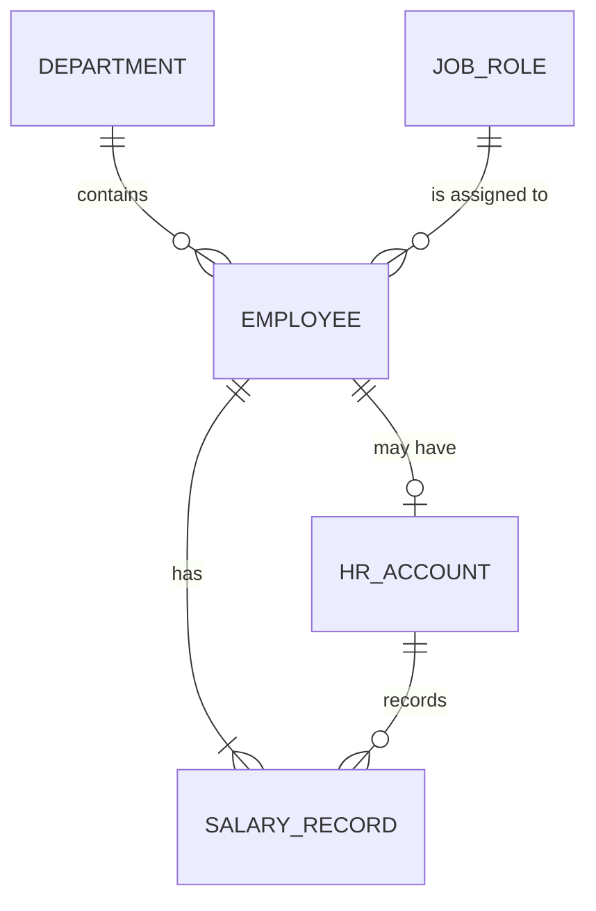

# ACME Salary Management | Database design v2

This design describes the Rails and SQLite data model for the [v1 product requirements](requirements.md). It covers employee records, HR access, salary history, CSV export, and compensation reporting.

## Relationships

## Tables

| Table | Fields | Constraints |
|---|---|---|
| `departments` | `id`, `name` | Unique department name. Seed the initial list. |
| `job_roles` | `id`, `name` | Unique role name. HR can create and rename roles. Assignments reference the role ID so a rename preserves them. |
| `employees` | `id`, `employee_number`, `full_name`, `country_code`, `department_id`, `job_role_id`, `joined_on`, `last_working_on` | Unique employee number. Department and job role are required foreign keys. The last working day is optional and must be on or after the joining date. |
| `hr_accounts` | `id`, `employee_id`, `email`, `password_digest` | One HR login per employee. Store a unique, normalized email and a password hash. The employee link is required. |
| `salary_records` | `id`, `employee_id`, `amount_minor`, `currency_code`, `effective_on`, `recorded_by_hr_account_id`, `created_at` | Unique `(employee_id, effective_on)`. Employee and author are required foreign keys. The amount must be a positive integer. The currency and effective date are required. |

Rails validates supported country and currency codes. Country describes where the employee works. Currency belongs to each salary entry and can change over time. `amount_minor` stores whole minor units, such as paise for INR or whole yen for JPY. Rails validates the amount against the currency’s decimal precision before converting it.

## Business rules

1. **Joining.** Create the employee profile and starting salary in one transaction. The starting salary takes effect on `joined_on`. If either record fails validation, roll back both.
2. **Salary changes.** Append a row for each change. The effective date must be within the employee’s employment period. Rails derives the author from the signed-in account and rejects changes to that manager’s own employee record. The database enforces unique effective dates, including when two requests submit the same date.
3. **Salary timeline.** Sort by effective date. Compare each increase with the immediately preceding salary in the timeline. For the same currency, the increase is the new amount minus the previous amount, and the percentage is that difference divided by the previous amount. For example, ₹10,00,000 to ₹11,00,000 is **+₹1,00,000 (10%)**. For currency changes, show both amounts and currencies and leave the change figures blank.
4. **Resignation.** Record the last working day for any employee, including HR staff. Both employment dates are inclusive. Keep former employees searchable and retain all salary records and their authors. Mark salary entries after the last working day as **unapplied**, with blank change figures. Rails checks the employment dates for each authenticated HR request, so an existing login session loses access after the last working day.
5. **Current salary and status.** Use one business date per request. An employee is active from their joining date through their last working day, when set. An active employee’s current salary is the latest eligible entry effective on or before that date. An eligible future entry is **scheduled**. Derive these states from dates so scheduled changes take effect without a background job.
6. **CSV and reports.** The employee CSV uses the same timeline as the detail page, with one row per salary entry and the employee’s profile and employment dates. Compensation reports take one current salary per active employee, apply country, department, and job-role filters, and calculate headcount, mean, and median separately for each currency.

## Query design

- Use the unique `(employee_id, effective_on)` index for an employee’s salary timeline and latest effective entry.
- Index the employee’s department, job role, and country for directory and reporting filters. Page directory results with a stable sort and employee ID as a tie-breaker.
- Select current salaries in one database query. Calculate mean and median in Ruby using exact arithmetic before rounding for display. Review query plans against the 10,000-employee seed data before adding more indexes.

## Validation and tests

Test the hire transaction and rollback, duplicate salary dates, invalid amounts and dates, same-currency and cross-currency changes, scheduled raises, and unapplied entries after resignation. Verify the last working day counts as active, former HR managers lose access, HR cannot change their own salary, and a second active HR manager can. Verify the CSV matches the timeline and the report counts each active employee once, in the correct currency.
